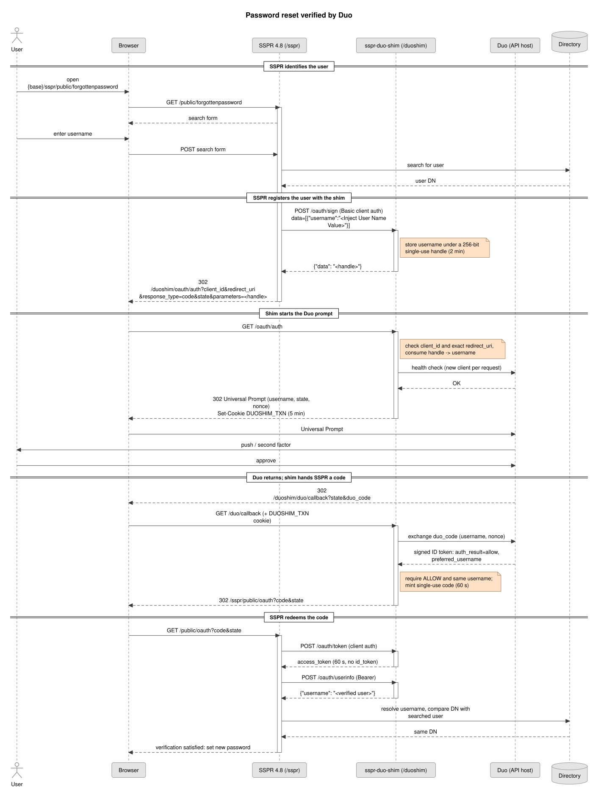

# sspr-duo-shim

A small Java web application that lets OpenText (NetIQ) **SSPR 4.8 Forgotten Password** verify users with **Duo's Universal Prompt** (Web SDK v4, second factor only). SSPR itself is not modified.

SSPR's *External OAuth Authentication* verification method expects an OAuth server with a non-standard `/sign` endpoint. Duo has none, and Duo SSO asks for the user's password first, which defeats the purpose of a password reset. The shim implements SSPR's OAuth dialect on one side and the Duo Web SDK on the other.

- [How it works](#how-it-works) (with sequence diagrams)
- [Build](#build)
- [Deploy on Tomcat next to SSPR](#deploy-on-tomcat-next-to-sspr)
- [Duo setup](docs/DUO-SETUP.md) (separate page)
- [SSPR Forgotten Password settings](#sspr-forgotten-password-settings)
- [Network requirements](#network-requirements)
- [Clustering](#clustering) and [active/standby](#high-availability-activestandby)
- [Upgrades](#upgrades)
- [Troubleshooting](#troubleshooting)
- [SSPR compatibility](#sspr-compatibility)
- [Security](SECURITY.md)
- [License](#license)

## How it works

```
 SSPR server            Browser                   shim (/duoshim)                  Duo
 ──────────             ───────                   ───────────────                  ───
 1. POST /oauth/sign  ───────────────────────────▶ store username under a
    (Basic auth, data=[{"username":"jdoe"}])       single-use handle (2 min)
                      ◀─────────────────────────── {"data":"<handle>"}
 2. redirect ────────▶  GET /oauth/auth ─────────▶ check client_id, exact redirect_uri,
                        ?client_id&redirect_uri    consume handle → jdoe,
                        &state&parameters=<handle> new Duo client, health check ─────────▶
                                                   set DUOSHIM_TXN cookie
                        ◀───────────────────────── 302 to Duo Universal Prompt
                        user approves in Duo ─────────────────────────────────────────────▶
                        GET /duo/callback ◀─────────────────────────────────────────────── 302
                        ?state&duo_code ─────────▶ cookie → transaction, check Duo state,
                                                   exchange duo_code for jdoe ───────────▶
                                                   require ALLOW and preferred_username=jdoe
                        ◀───────────────────────── 302 to SSPR /public/oauth?code&state
 3. POST /oauth/token ───────────────────────────▶ consume code (60 s) → access token (60 s)
 4. POST /oauth/userinfo (Bearer) ───────────────▶ consume token → {"username":"jdoe"}
```

Sequence diagrams (source: [docs/sequence.flow](docs/sequence.flow), rendered with the FlowDiagram `fdiag` CLI):

- [Password reset verified by Duo](docs/sequence-reset_with_duo.svg)
- [Duo attempt that never returns (deny, unenrolled, timeout) and *Start over*](docs/sequence-unfinished_attempt.svg)



The username that comes back to SSPR is always the one SSPR registered in step 1, and Duo must have approved exactly that user. Nothing the browser sends can choose or change it. Every handle, transaction, code and token is 256-bit random, single use and short-lived.

| Endpoint | Caller | Purpose |
|---|---|---|
| `POST /oauth/sign` | SSPR server | Register the user to verify; returns a handle |
| `GET /oauth/auth` (also `/oauth/grant`) | Browser | Start the Duo prompt |
| `GET /duo/callback` | Browser (from Duo) | Finish the Duo prompt; redirect to SSPR with a code |
| `GET /health` | Load balancer | 200 when the shim is up; `?duo=1` also checks Duo (503 if unreachable) |
| `GET /oauth/startover` | Browser | "Start over" on the *did not finish* page: void the attempt, clear the cookie, return to SSPR's cancel path |
| `POST /oauth/token` | SSPR server | Code → access token |
| `GET` or `POST /oauth/userinfo` | SSPR server | Access token → verified username |

## Build

Building requires **JDK 17+** and Maven 3.9+ (the unit tests are compiled for Java 17).

```bash
mvn clean package
```

The output is `target/duoshim.war`. It targets **javax.servlet 4.0 (Tomcat 9)**, the same container generation as SSPR 4.8.0.600, whose WAR is compiled against `javax.servlet`. A Tomcat 10+ (`jakarta.*`) deployment would need a jakarta build of the shim.

The WAR itself runs on **Java 11 or newer**: the shim is compiled with `--release 11`, and every bundled library targets Java 8 or 9. SSPR 4.8.0.600 is itself compiled for Java 11, and the lab's SSPR 4.7 Tomcat runs on OpenJDK 11.0.19, so the shim can share SSPR's Tomcat. Smoke-tested on Tomcat 9.0.86 with Java 11.0.20 and Java 17.

Runtime dependencies are the Duo Universal SDK 1.4.0 and what it brings in (Retrofit, OkHttp, Jackson, java-jwt). There is no web framework.

## Deploy on Tomcat next to SSPR

1. **Configuration file.** Copy `duoshim.properties.example` to a path outside the WAR, for example `/etc/duoshim/duoshim.properties`, fill it in, and restrict it:
   ```bash
   chown root:tomcat /etc/duoshim/duoshim.properties && chmod 640 /etc/duoshim/duoshim.properties
   ```
2. **Point Tomcat at it.** In `bin/setenv.sh` (create it if missing):
   ```bash
   CATALINA_OPTS="$CATALINA_OPTS -Dduoshim.config=/etc/duoshim/duoshim.properties"
   ```
   Alternatively, set the environment variable `DUOSHIM_CONFIG`.
3. **Deploy** `duoshim.war` into the same `webapps/` directory as `sspr.war`. The context path becomes `/duoshim`, matching the URLs below.
4. **Audit log (recommended).** Audit lines go to the java.util.logging logger `duoshim.audit`. To write them to their own file, add this to `conf/logging.properties`:
   ```properties
   handlers = 1catalina.org.apache.juli.AsyncFileHandler, ..., 9duoshim.org.apache.juli.AsyncFileHandler
   9duoshim.org.apache.juli.AsyncFileHandler.level = INFO
   9duoshim.org.apache.juli.AsyncFileHandler.directory = ${catalina.base}/logs
   9duoshim.org.apache.juli.AsyncFileHandler.prefix = duoshim-audit.
   9duoshim.org.apache.juli.AsyncFileHandler.maxDays = 90
   duoshim.audit.handlers = 9duoshim.org.apache.juli.AsyncFileHandler
   duoshim.audit.useParentHandlers = false
   ```
   (Keep your existing handlers in the `handlers =` list; `...` stands for them.) The `9duoshim.` prefix is Tomcat's way of naming a separate instance of a handler class: a leading digit, a name, then a dot, like the stock `1catalina.` and `2localhost.`. Any number not already used works, as long as it's the same on every line.
5. **Restart Tomcat.** On success, `catalina.out` shows `duoshim started: ShimConfig{...}`, which lists no secrets. On any configuration problem it shows `duoshim startup aborted: <every problem found>` and the `/duoshim` context does not start.
6. **Reverse proxy, load balancer or tunnel.** See [Behind a reverse proxy or tunnel](#behind-a-reverse-proxy-or-tunnel).
7. **Logging.** See [Logs and URLs](#logs-and-urls).

### Behind a reverse proxy or tunnel

The shim takes the source IP for rate limiting and the audit log from `request.getRemoteAddr()`. It never reads `X-Forwarded-For` itself, because anyone can send that header. Behind a proxy, load balancer or tunnel, `getRemoteAddr()` is the proxy's own address. Every user then shares one address, and each per-IP limit becomes a single limit for everyone. Configure Tomcat's `RemoteIpValve` (in `conf/server.xml`, inside `<Host>`) so Tomcat replaces the address with the real client IP, trusting the header **only** when the request comes from your proxy:

```xml
<!-- Generic reverse proxy that sets X-Forwarded-For and X-Forwarded-Proto -->
<Valve className="org.apache.catalina.valves.RemoteIpValve"
       internalProxies="10\.0\.0\.5"
       remoteIpHeader="X-Forwarded-For"
       protocolHeader="X-Forwarded-Proto" />
```

```xml
<!-- Cloudflare Tunnel: cloudflared connects from this address; Cloudflare sets CF-Connecting-IP -->
<Valve className="org.apache.catalina.valves.RemoteIpValve"
       internalProxies="127\.0\.0\.1|0:0:0:0:0:0:0:1"
       remoteIpHeader="CF-Connecting-IP"
       protocolHeader="X-Forwarded-Proto" />
```

`internalProxies` is a regular expression matching only your proxy's address. The valve applies to every webapp in the `<Host>`, so SSPR gets real client IPs too, which its own intruder detection needs.

Without the valve, the shim still protects SSPR's own calls: `/oauth/sign` checks client authentication before any per-IP limit, and failed attempts count against a separate per-IP budget (`ratelimit.sign.failuresPerIp`). Anonymous traffic therefore can't use up SSPR's allowance. The browser-facing limit on `/oauth/auth` still needs real client IPs to be meaningful.

### Logs and URLs

The shim's own logs never contain handles, codes, tokens or secrets. These values do travel in URLs, though: the handle (`parameters`), SSPR's `state`, Duo's `duo_code`, and the authorization `code` on the way back to SSPR. Anything that logs full request URLs can capture them while they're still valid (minutes at most):

- **Tomcat access log.** The default `AccessLogValve` pattern logs `%r`, the request line including the query string. Use a pattern without the query string, for example `pattern="%h %l %u %t &quot;%m %U %H&quot; %s %b"` (`%U` is the path only).
- **SSPR's own log.** At TRACE or DEBUG level, SSPR writes the OAuth return URL, including `code` and `state`. Keep SSPR at INFO outside test systems.
- **Proxies and tunnels** may log URLs too. Check their settings.

A code alone can't be redeemed: `/oauth/token` also requires the SSPR client secret.

## Duo setup

See **[docs/DUO-SETUP.md](docs/DUO-SETUP.md)**. It covers creating the Web SDK application, the application policy, user names and network access. The policy settings decide whether a reset really requires a second factor, so don't skip them.

## SSPR Forgotten Password settings

In the SSPR configuration editor, open **Settings ▸ Modules ▸ Public ▸ Forgotten Password ▸ Profiles ▸ *your profile***.

1. **Verification Methods:** enable **External OAuth Authentication** as required (or optional, if that fits your policy).
2. **OAuth** section of the profile (`{base}` is the public `https://host[:port]`):

| SSPR setting | Value |
|---|---|
| OAuth Login URL | **SSPR 4.7 and 4.8:** `{base}/duoshim/oauth/auth` · SSPR 4.5: `{base}/duoshim/oauth/grant` |
| OAuth Code Resolve Service URL | `{base}/duoshim/oauth/token` |
| OAuth Profile Service URL | `{base}/duoshim/oauth/userinfo` |
| OAuth Client ID | same as `sspr.clientId` |
| OAuth Shared Secret | same as `sspr.clientSecret` |
| OAuth User Name/DN Login Attribute | same as `userinfo.attribute` (default `username`) |
| OAuth Inject User Name Value | A macro giving the user's **Duo username**, for example `@LDAP:cn@` or `@LDAP:mail@`. **Required:** if it is blank, SSPR never calls `/sign` and the shim rejects the request. |
| Skip Authorization header in OAuth Code Resolve request | **Off.** In 4.8 this also removes client authentication from the `/sign` call, which the shim then rejects. |
| OAuth Web Service Server Certificate | The shim's TLS certificate (or its CA), if SSPR doesn't already trust it. SSPR calls the shim over HTTPS. |
| Add login hint optional parameter… | Blank (the shim ignores it). |

Why the Login URL ends in `/auth` on 4.7 and 4.8: SSPR 4.8 builds the `/sign` URL by keeping everything up to the last `/auth` in the Login URL and appending `sign`. `{base}/duoshim/oauth/auth` therefore gives `{base}/duoshim/oauth/sign`. With a Login URL ending in `/grant`, SSPR 4.8 computes a sign URL of just `sign` and the reset fails. SSPR 4.5 instead replaced `/grant` with `/sign`. The shim serves both `/oauth/auth` and `/oauth/grant`.

3. **Elsewhere in SSPR:**
   - **Settings ▸ Application ▸ Application ▸ Site URL** must be set. SSPR builds its OAuth return address as `<Site URL>/public/oauth`, and `sspr.redirectUri` must equal it **exactly** (scheme, host, port, path, no trailing slash). The `oauth.returnUrlOverride` app property, if set, takes precedence over the Site URL.
   - **SSO ▸ OAuth ▸ OAuth Profile / UserInfo Service Method Type** (4.8): `POST` or `GET` both work.
   - The *Inject User Name Value* must also resolve to the same user through SSPR's **LDAP Username Search Filter**. SSPR looks up the returned username that way and compares the DN with the user found on the search page. For example, if the macro is `@LDAP:mail@`, the username search filter must match `mail`.

The shim never returns an `id_token`. That keeps SSPR 4.8 out of its OIDC branch, which would read the username using the **SSO** profile's attribute name instead of the Forgotten Password profile's.

## Network requirements

| From | To | Why |
|---|---|---|
| SSPR server | Shim's **public** URL (`{base}/duoshim/...`), HTTPS | `/sign`, `/token`, `/userinfo` are server-to-server calls to the URLs configured in SSPR. When SSPR and the shim share a server, that server must be able to reach its **own public host name** (DNS and NAT hairpin, or a hosts-file entry pointing it at itself). |
| Shim server | `duo.apiHost`:443 | Health check and code exchange. Duo's CAs are pinned, so no TLS interception. |
| Browsers | Shim public URL, `duo.apiHost` | Prompt start, Universal Prompt, callback. |

The host name in the **OAuth Login URL** and the host name in `duo.redirectUri` must be the **same**. The transaction cookie set at `/oauth/auth` is host-specific and limited to the `/duoshim` path.

## Clustering

**The shim keeps all state in memory on one node.** The SSPR server calls `/sign`, `/token` and `/userinfo`, which carry no browser cookie. The browser calls `/oauth/auth` and `/duo/callback`. All five must reach the **same shim instance**, and sticky sessions cannot arrange that for the server-to-server calls.

- **Supported:** one shim instance at a time, either on its own or as an [active/standby pair](#high-availability-activestandby). Every SSPR node points at the same shim URL, so this works with a clustered SSPR.
- **Not supported as built:** several shim instances serving traffic at once (active/active). That needs a shared store, for example PostgreSQL or Redis with an atomic get-and-delete, so codes stay single use. The state is confined to `duoshim.store.ExpiringStore` and `RateLimiter`, so that is a contained change.
- A restart or failover drops in-flight resets. Those users see a shim error page (the shim fails closed) and start the reset again.

### High availability (active/standby)

Run two shim instances with **exactly one receiving traffic at a time**. A load balancer, or a floating IP, switches to the standby when the active one fails its health check.

**Layout.** Serve SSPR and the shim under **one public host name**: the shim's transaction cookie is per host, and SSPR's Site URL, the OAuth Login URL and `duo.redirectUri` must share that host. Route by path:

| Path | Backend | Balancing |
|---|---|---|
| `/sspr/*` | All SSPR nodes | Sticky sessions (SSPR keeps forgotten-password progress in its HTTP session) |
| `/duoshim/*` | Shim A (active), shim B (backup) | **One server at a time**, never round robin |

The shim can be a second webapp in each SSPR node's Tomcat (as on the lab host), with only one copy receiving `/duoshim` traffic. Or it can run on separate hosts. SSPR's server-to-server calls (`/sign`, `/token`, `/userinfo`) use the same public URL, so they also go through the load balancer to the active shim. Each SSPR node must be able to reach that public URL.

**Health check.**
- `GET /duoshim/health` returns 200 `{"status":"ok"}` when the shim has started. If its configuration is invalid the webapp never starts, and Tomcat returns 404.
- `GET /duoshim/health?duo=1` also checks that Duo is reachable with the configured credentials: 200 when it is, 503 `{"status":"degraded","duo":"unavailable"}` when it isn't. The Duo result is cached for 15 seconds, so frequent probes don't flood Duo.
- Use plain `/health` for failover. Duo being unreachable affects both nodes equally, so failing over wouldn't help. Monitor `?duo=1` separately and alert on it.

**Configuration on both nodes.**
- Use an identical `duoshim.properties`: the same Duo client ID, secret and API host, the same `sspr.clientId`/`sspr.clientSecret`, and the same `duo.redirectUri` and `sspr.redirectUri` (the shared public host name). Install with `deploy/install-duoshim.sh` on each node.
- Rotate secrets on both nodes together, and restart the standby first.
- Behind a proxy, configure Tomcat's `RemoteIpValve` on both nodes so rate limits and the audit log see client IPs rather than the load balancer's.
- Each node writes its own audit log. Ship both to the same log collector.

**Failback.** When the active node comes back, switching back to it immediately drops the resets running on the standby a second time. If your load balancer supports it, stay on the standby until someone fails back deliberately.

**HAProxy example.** The `stick on dst` lines are the usual HAProxy pattern for active/standby without automatic failback: once traffic moves to the backup, it stays there.

```haproxy
frontend https_in
    bind :443 ssl crt /etc/haproxy/certs/sspr.pem
    acl is_shim path_beg /duoshim/
    use_backend duoshim if is_shim
    default_backend sspr

backend sspr
    balance roundrobin
    cookie SSPRNODE insert indirect nocache
    server sspr1 10.0.0.11:8443 ssl verify required ca-file /etc/haproxy/lab-ca.pem check cookie s1
    server sspr2 10.0.0.12:8443 ssl verify required ca-file /etc/haproxy/lab-ca.pem check cookie s2

backend duoshim
    option httpchk GET /duoshim/health
    http-check expect status 200
    stick-table type ip size 1 nopurge
    stick on dst
    server shim1 10.0.0.11:8443 ssl verify required ca-file /etc/haproxy/lab-ca.pem check
    server shim2 10.0.0.12:8443 ssl verify required ca-file /etc/haproxy/lab-ca.pem check backup
```

**nginx example.** Open-source nginx only has passive health checks (`max_fails`/`fail_timeout`). Active checks against `/duoshim/health` need NGINX Plus or an external monitor. It also fails back automatically.

```nginx
upstream duoshim {
    server 10.0.0.11:8443 max_fails=2 fail_timeout=15s;
    server 10.0.0.12:8443 backup;
}
location /duoshim/ {
    proxy_pass https://duoshim;
    proxy_set_header X-Forwarded-For $proxy_add_x_forwarded_for;
    proxy_set_header X-Forwarded-Proto https;
}
```

**Floating IP instead of a load balancer.** With keepalived (VRRP) on two shim hosts, use a `vrrp_script` that runs `curl -fsk https://localhost:8443/duoshim/health`. Point the public name's `/duoshim` path at the virtual IP through your existing reverse proxy. Set `nopreempt` on the instances, so the VIP doesn't move back automatically.

**Test the failover before relying on it.**
1. Start a reset and complete it.
2. Stop the active shim (`systemctl stop tomcat`, or undeploy `duoshim.war`) and confirm the load balancer marks it down.
3. Start a new reset and complete it through the standby. Its audit log should show the five events.
4. Start a reset, fail over in the middle of it, and confirm the user gets a shim error page and can start again.

## Upgrades

- **SSPR upgrades:** the shim depends on SSPR's OAuth client behaviour, not on SSPR code. After any SSPR upgrade, run one reset end to end and confirm the shim's audit log shows `sign`, `grant`, `duo_callback`, `token` and `userinfo`. If it fails, compare with [SSPR compatibility](#sspr-compatibility): especially how the `/sign` URL is derived, the token-response handling (`id_token`) and the userinfo method.
- **Moving to Tomcat 10+:** SSPR itself must move to `jakarta.*` first. The shim would need a jakarta build (rename the imports, swap the servlet API dependency).
- **Duo SDK:** bump `duo.sdk.version` in `pom.xml`, run `mvn clean package` (the tests use a fake Duo), then test against Duo.
- **Shim upgrades:** replace `duoshim.war`. The configuration file stays where it is, and in-flight transactions are lost (see above).
- **Secrets:** to rotate `sspr.clientSecret`, change it in SSPR and the properties file together, then restart the shim. To rotate `duo.clientSecret`, rotate it in Duo, update the file, then restart.

## Troubleshooting

Start with the shim's audit log (`event=… user="…" result=… ip=…`) and `catalina.out`.

| Symptom | Likely cause | Fix |
|---|---|---|
| `/duoshim` returns 404; log shows `duoshim startup aborted: …` | Missing or invalid configuration; the message lists every problem | Fix the properties file and restart. |
| SSPR: *error during OAuth pre-inject username signing service* with URL `sign` | SSPR 4.8 with a Login URL that doesn't contain `/auth` | Use `{base}/duoshim/oauth/auth`. |
| SSPR: *unexpected HTTP status code (401) during OAuth pre-inject…*; audit `event=sign result=invalid_client` | Client ID/secret mismatch, or *Skip Authorization header* on | Match `sspr.clientId`/`sspr.clientSecret`; turn the skip option off. |
| Shim page *This verification link has expired or was already used*; audit `invalid_or_expired_handle` | *Inject User Name Value* blank (no `/sign` call), more than 2 minutes between `/sign` and the browser arriving, or a reload | Set the macro; start again. |
| Shim page *unexpected return address*; audit `invalid_redirect_uri` | `sspr.redirectUri` doesn't exactly equal `<Site URL>/public/oauth` | Compare character by character (trailing slash, port, http vs https). |
| Shim page *Duo verification is unavailable*; audit `duo_unavailable` | Shim can't reach `duo.apiHost`, TLS interception, wrong Duo credentials | `curl https://<apiHost>` from the shim server; check proxy exemptions; check the Duo values. |
| Shim page *not started in this browser, or cookies are blocked*; audit `no_transaction_cookie` | Login URL host differs from the `duo.redirectUri` host, cookies blocked, or `cookie.secure=true` over plain HTTP | Use one host name for both; use HTTPS. |
| Duo prompt shows *user not found / not enrolled*, or audit `denied` | Duo username differs from the injected value, or New User policy = Deny for an unenrolled user | Fix the macro or the Duo username/alias; enrol the user. |
| Audit `duo_exchange_failed` after the user approved in Duo (or, rarely, `user_mismatch`) | The username Duo returns must equal the one SSPR sent **exactly, including case**. The Duo SDK enforces this, and the shim checks it again. Duo username normalisation, or a differently cased *Inject User Name Value*, breaks the match. | Make the macro produce the username exactly as Duo stores it; check Duo's username normalisation setting. |
| Audit `state_mismatch` | Two Duo prompts in one browser (the newest cookie wins), or a tampered callback | Finish one reset at a time. |
| Duo approves, then SSPR shows the username screen again. Audit has `duo_callback … result=allow` but no `token` line; SSPR log: `read state … match=false` / `response is not for a request issued during the current session` | The reset was started on a different host name (IP address, short name, old name) than SSPR's **Site URL**. SSPR sends the browser back to the Site URL host, where the browser has no SSPR session cookie. | Open SSPR only at the Site URL host, for example `https://sspr-test.pointbluetech.com:8443/sspr/public/forgottenpassword`. Optionally redirect other names to it at the proxy. |
| After an unfinished attempt (Duo denied an unenrolled user, or the Duo window was closed), the shim shows *Your last Duo verification did not finish*; audit `repeat_choice` | Expected. SSPR keeps the forgotten-password attempt open and sends the user straight back to the shim. Duo's deny page never returns, so SSPR doesn't know the attempt ended. | *Start over* (via `/oauth/startover`) voids the attempt, clears the shim's cookie and returns to SSPR's username page through SSPR's cancel path. *Try Duo again* opens a fresh Duo prompt. If the user just leaves, the next reset in that browser within 5 minutes also sees this page once. |
| SSPR: *OAuth server did not respond with an username value for configured attribute* | `userinfo.attribute` ≠ SSPR's *OAuth User Name/DN Login Attribute* | Make them equal. |
| SSPR: *oauth server username does not match previously identified user* | The injected value resolves, through SSPR's LDAP Username Search Filter, to a different DN than the one the search page found | Use an attribute the username search filter matches (for example `cn`). |
| SSPR: token error 400; audit `invalid_grant` | Code older than 60 s, or the redirect URI SSPR sent differs | Check clock and load; check Site URL. |
| HTTP 429 or *Too many attempts* | Rate limit reached | Wait for `ratelimit.windowSeconds`, or tune the limits. |

## SSPR compatibility

How SSPR's OAuth client behaves for the Forgotten Password method, by version, and what the shim does about it:

| Behaviour | 4.5.0.1 | 4.7.0.0 and 4.8.0.600 | Shim |
|---|---|---|---|
| `/sign` URL | Login URL with `/grant` replaced by `/sign` | Login URL up to and including the `/` before the last `/auth`, plus `sign` | Serves `/oauth/sign`; grant on both `/oauth/grant` and `/oauth/auth` |
| `/sign` request | POST form `data=[{"username":…}]`, HTTP Basic | Same; 4.8 omits Basic if *Skip Authorization header* is on | Requires client auth |
| `/sign` response | JSON `data` field | Same | `{"data":"<handle>"}` |
| Browser redirect params | `client_id`, `response_type=code`, `state`, `redirect_uri`, `scope` (if set), `parameters` | Same; 4.8 adds `login_hint` (if set) and always sends `scope=openid` | Uses `client_id`, `redirect_uri`, `response_type`, `state`, `parameters`; ignores the rest |
| Token request | POST form `code`, `grant_type`, `redirect_uri`, `client_id`, `client_secret` + Basic | Same; 4.8 omits Basic if skip is on | Accepts Basic or form credentials |
| Token response | Reads `access_token`, `expires_in`, `refresh_token` | 4.8: if `id_token` is present, takes the username from it using the SSO attribute | Returns `access_token`, `token_type`, `expires_in`, **no `id_token`** |
| Userinfo | POST, Bearer header + form `access_token`, `attributes` | 4.8: POST, or GET with Bearer only when the global method type is GET | Accepts both; token from Bearer, or form field on POST |
| Return check | — | 4.8: resolves the returned username via LDAP and compares DNs exactly | Returns the injected value unchanged |

**Notes:**
- On 4.7 and 4.8 the OAuth Login URL must end in `/auth`. The `/grant` form only works on 4.5.
- The shim never returns an `id_token`, so 4.8 always takes the username from `/oauth/userinfo` and the Forgotten Password profile's attribute name.
- *Start over* on the *did not finish* page relies on SSPR treating `error=access_denied&sub_error=usrcan` as a user cancel, which clears the forgotten-password attempt. This is confirmed on 4.8.0.600 only. If another version shows an OAuth error instead, the user needs a new browser session (or to wait about 5 minutes for SSPR's session to expire).

**Tested end to end** on SSPR 4.8.0.600 (Tomcat 9.0.124, Java 11) with a real Duo Web SDK application: approved push, unenrolled user, denied push, timed-out push, and *Start over* after an unfinished attempt.

**Not tested end to end:**
- SSPR 4.5 and 4.7, and 4.8 builds other than 4.8.0.600.
- How SSPR's HTTP client handles the shim's TLS certificate without *OAuth Web Service Server Certificate* set.
- The exact effect of Duo username normalisation on `preferred_username`.

## License

[MIT](LICENSE). Copyright (c) 2026 PointBlue Technology.

`duoshim.war` also bundles third-party libraries under their own licenses: the Duo Universal SDK, Jackson, Retrofit, OkHttp, Okio and java-jwt. If you redistribute the WAR, include their notices as their licenses require.
